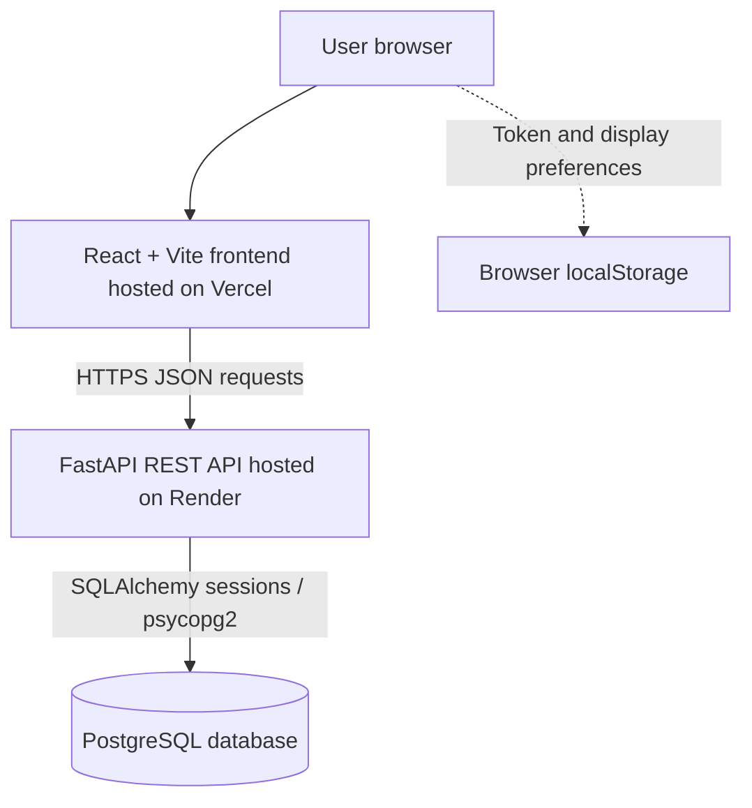
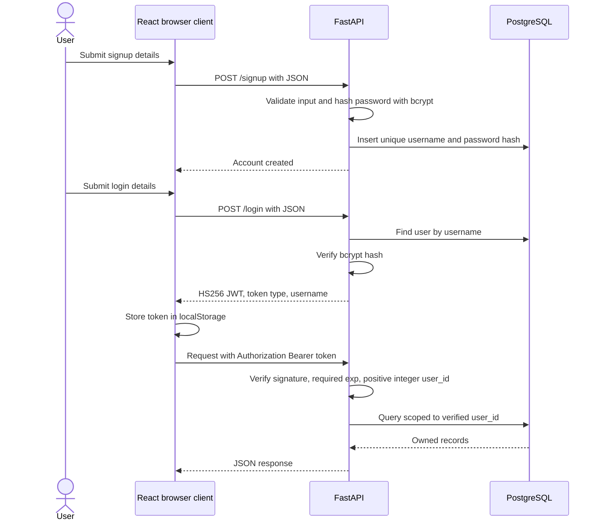

# Architecture

Internship Tracker is a React single-page application backed by a FastAPI REST API and PostgreSQL. The frontend and backend are deployed independently. The current code has no AI model, recommendation service, background queue, or external analytics service.

## Deployment boundary

Vercel serves the compiled static assets. React calls the API configured through `VITE_API_URL`; PostgreSQL credentials never enter the frontend. The API uses a SQLAlchemy session per request and closes it when the request completes. The diagram shows responsibilities, not an assertion about private database network settings.

## Frontend structure

| Area | Responsibility |
| --- | --- |
| `App.jsx` | Public/protected page selection and workspace composition |
| `hooks/useTracker.js` | Authentication, application loading, CRUD, request cancellation, stale-session checks, mutation locking |
| `hooks/useNavigation.js` | Hash routes, browser history, and same-route navigation events |
| `hooks/useTheme.js` | Theme preference and document colors |
| `api.js` | API URL normalization, Bearer headers, response validation, readable errors, stale-token-aware 401 handling |
| `utils/applications.js` | Summary metrics, filtering, stable sorting, calendar-month trends |
| `components/` | Landing, authentication, navigation, cards/tables, forms, feedback, charts |

Routes are `/#/login`, `/#/signup`, `/#/overview`, and `/#/applications`. The root is a public landing page. Protected routes redirect anonymous visitors to login with an allowlisted internal return target. Backend authentication remains the actual security boundary. Recharts loads on demand; its error boundary keeps application editing available if the chart module cannot load.

## JWT authentication flow

PyJWT signs `user_id` and `exp` using the backend `SECRET_KEY`. Tokens last 24 hours. Decoding explicitly allows only HS256, requires expiration, and rejects invalid signatures or claims with HTTP 401 and a Bearer challenge. User IDs must be positive integers; booleans and numeric strings are rejected. The application does not derive the accepted algorithm from an untrusted token header.

Passwords are hashed with bcrypt. The API checks the 72-byte UTF-8 limit before hashing, enforces unique usernames, and handles duplicate-signup races. Signup and login accept JSON, not an OAuth password-form body. The Swagger OAuth2 “Authorize” form therefore does not match this custom login contract; API clients should obtain a token from JSON `/login` and send the Bearer header themselves.

## Routes and ownership

| Method | Route | Authentication | Behavior |
| --- | --- | --- | --- |
| GET | `/` | Public | Service greeting; does not verify database connectivity |
| POST | `/signup` | Public | Create account; duplicate username returns 409 |
| POST | `/login` | Public | Verify credentials and issue JWT; invalid credentials return 401 |
| GET | `/internships` | Bearer JWT | Return only the authenticated user's records |
| POST | `/internships` | Bearer JWT | Assign ownership from the verified token |
| PUT | `/internships/{id}` | Bearer JWT | Update only where both record ID and owner match |
| DELETE | `/internships/{id}` | Bearer JWT | Delete only where both record ID and owner match |

An update/delete for another user's record returns 404. Client-supplied ownership cannot override the verified token. Request validation covers required values, status, dates, length limits, and HTTP(S) job URLs. CORS wraps the whole app, including error responses, and permits explicit origins and headers; CORS is not an authorization mechanism.

## Database design

| Table | Fields |
| --- | --- |
| `users` | Integer primary-key `id`; unique non-null `username`; non-null `password` containing a bcrypt hash |
| `internships` | Integer primary-key `id`; company, role, status, application date, integer `user_id`; optional location, job URL, notes |

`user_id` is the logical association between the tables. **There is currently no database foreign-key constraint or ORM relationship enforcing it.** API queries enforce ownership. JWT verification does not separately query whether the referenced user still exists; the application currently has no user-deletion endpoint. See the migration requirements below before adding one.

Application statuses are Applied, Assessment, Interview, Offer, Selected, Rejected, and Withdrawn. Allowed statuses and string limits are enforced by application validation, not by database enum/check constraints. SQLAlchemy `String` columns do not currently declare those lengths.

## Analytics

Analytics are computed in the browser from the existing authenticated `GET /internships` response. There is no separate analytics endpoint or database aggregation service.

- **Total:** number of the user's loaded applications.
- **Interview/offer counts:** records currently at those statuses. Selected is separate from Offer.
- **Selection rate:** Selected divided by total, shown as a percentage; empty datasets show zero.
- **Active:** Applied + Assessment + Interview + Offer.
- **Trend:** application-date counts by calendar month, including empty months. Six/twelve-month ranges include the current month. All-time ranges include the earliest date through the current/latest month and group into at most 24 buckets.

List filters do not change overview totals. Search, sorting, and eight-record pagination happen in the browser after loading the full user dataset. Trend calculations avoid converting date-only values through local time zones. These are descriptive counts, not hiring predictions, conversion funnels, or historical interview/offer events.

## Environments and configuration

| Environment | Frontend/API | Database and data |
| --- | --- | --- |
| Local development | Vite 5173 → loopback API 8000 | Developer-created local PostgreSQL |
| Backend unit tests | Direct ASGI requests | In-memory SQLite, synthetic key/accounts |
| Browser tests and screenshots | Vite 5174 (or override) → API 8001 | New temporary PostgreSQL cluster; synthetic records |
| Production | Vercel → Render over HTTPS | Deployment PostgreSQL; private backend settings |

`DATABASE_URL` and `SECRET_KEY` belong only to the backend. `CORS_ORIGINS` adds trusted browser origins. `VITE_API_URL` is public and embedded at build time. [Configuration reference](DEVELOPMENT.md).

## Limitations and migrations

- `Base.metadata.create_all()` runs when the API is imported. It creates missing tables but does not upgrade an existing schema. Do not treat a code change to `models.py` as a migration.
- Adding a foreign key requires an orphan-record audit, explicit deletion/update policy, a reviewed migration tool such as Alembic, staging verification, and backup/rollback planning. Indexing `internships.user_id` should be evaluated alongside query plans as data grows. No production audit or migration has been run as part of this documentation work.
- JWT storage in localStorage leaves tokens accessible to JavaScript; React text escaping is not a complete XSS defense. Logout clears the local token but does not revoke it at the server. There are no refresh tokens, server-side revocation, password recovery, or authentication rate limits.
- API lists are unpaginated, and charts/search operate on the complete response. Larger datasets may need server-side pagination/filtering and dedicated aggregates.
- There is no persisted status-event history. Historical conversion or time-in-stage analytics would need new tables and carefully defined events.
- Tests cover SQLite API behavior and disposable PostgreSQL browser flows, not production load, multi-instance deployment, disaster recovery, or all native browsers.

[Back to documentation](README.md).
